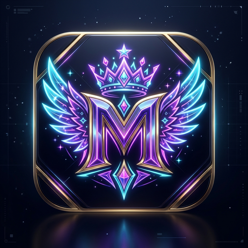

<div align="center">



# 🌸 MİRA Broadcast Studio

**Kick & TikTok Live için profesyonel yayın kontrol masası, OBS overlay'leri ve stream deck.**


[⬇️ İndir](#-hızlı-kurulum) · [⚙️ İlk Kurulum](#️-i̇lk-açılış-her-şey-arayüzden) · [🎬 Sahneler](#-obs-sahne-bağlantıları) · [❓ SSS](#-sorun-giderme)

</div>

---

## ✨ MİRA Nedir?

MİRA Broadcast Studio; yayıncının **tek bir masaüstü uygulamasından** canlı sohbeti, alert'leri, hedef çubuğunu, sesli okumayı (TTS), müziği ve OBS'i yönetmesini sağlar. Kurulumdan sonra **hiçbir dosyayı elle düzenlemeniz gerekmez** — tüm ayarlar MİRA Studio arayüzündedir.

| Özellik | Açıklama |
| :--- | :--- |
| 💬 **Canlı Sohbet** | Kick (Pusher WebSocket) ve BotRix/TikFinity widget desteği, yayıncı olarak mesaj gönderme |
| 🔔 **Alert Sistemi** | Takip, abone, hediye abone, Kicks/bağış ve raid alert'leri, özelleştirilebilir şablonlar |
| 🎯 **Hedef & İstatistikler** | Takipçi hedefi, Kick ile canlı senkron, yayın başına sayaçlar, son takipçi/abone/destek HUD'u |
| 🎙️ **TTS Seslendirme** | Türkçe seslendirme, ses gücü (%250'ye kadar), hız ve perde (pitch) ayarı |
| 🎚️ **Audio Ducking** | TTS konuşurken OBS müziğini otomatik kısar |
| 🎵 **Müzik Paneli** | Spotify/Tuna senkronu, albüm kapağı, ilerleme çubuğu, OBS müzik sesi kontrolü |
| 🖼️ **Galeri & Editör** | Sürükle-bırak overlay editörü, hazır şablonlar (Vexana Full Set, Elmas Bağış Alerti, Forge Kartı…) |
| 🎮 **5 Hero Sahnesi** | 💀 Vexana · 👑 Zetian · 🐾 Nana · 🩸 Carmilla · ⚓ Atlas — Kick ve TikTok için ayrı |
| 🪟 **Yüzen Sohbet** | Her zaman üstte kalan kompakt sohbet penceresi |

---

## ⬇️ Hızlı Kurulum

En kolay yol: **[Releases sayfasından](https://github.com/cihan-atas/mira-broadcast-studio/releases/latest)** işletim sisteminize uygun paketi indirin.

| İşletim Sistemi | Paket | Not |
| :--- | :--- | :--- |
| 🪟 Windows | `MIRA.Broadcast.Studio.Setup.1.0.0.exe` | Kurulum sihirbazı, masaüstü kısayolu ekler |
| 🪟 Windows | `MIRA.Broadcast.Studio.1.0.0.exe` | Portable, kurulum gerektirmez |
| 🐧 Linux | `MIRA.Broadcast.Studio-1.0.0.AppImage` | Tüm dağıtımlar, kurulumsuz |
| 🐧 Linux | `mira-broadcast-studio_1.0.0_amd64.deb` | Debian / Ubuntu / Mint / Pop!_OS |

**AppImage:** `chmod +x MIRA.Broadcast.Studio-*.AppImage && ./MIRA.Broadcast.Studio-*.AppImage`
**deb:** `sudo dpkg -i mira-broadcast-studio_1.0.0_amd64.deb`

> [!NOTE]
> Windows SmartScreen "bilinmeyen yayıncı" uyarısı verebilir (uygulama imzasızdır). **Ek bilgi → Yine de çalıştır** ile devam edebilirsiniz.

### 📥 Kaynak koddan kurulum (alternatif)

Paket indirmek yerine depoyu klonlayıp otomatik sihirbazı da kullanabilirsiniz. Sihirbaz Node.js, FFmpeg ve bağımlılıkları kurar, masaüstü kısayolu ekler ve uygulamayı başlatır.

```bash
git clone https://github.com/cihan-atas/mira-broadcast-studio.git
cd mira-broadcast-studio
```

| | Windows | Linux |
| :--- | :--- | :--- |
| **Kurulum + başlatma** | `kurulum.bat` (çift tıkla) | `./kurulum.sh` |
| **Sonraki açılışlar** | `baslat.bat` | `./baslat.sh` |
| **Sadece sunucu + tarayıcı** | `baslat-server.bat` | `./baslat-server.sh` |
| **Paketleri kendin derle** | `npm run dist:win` | `npm run dist:linux` |

Gereksinim: yalnızca internet bağlantısı. Node.js ve FFmpeg yoksa sihirbaz kurar (Windows: `winget`, Linux: `apt` / `pacman` / `dnf` / `zypper`).

---

## ⚙️ İlk Açılış: Her Şey Arayüzden

MİRA hiçbir kişisel bilgi olmadan temiz açılır. Aşağıdakilerin tamamı Studio içinden yapılır:

1. **Kick kanalı:** Üst bardaki **`⚙️ Kanal Bağla`** rozetine tıklayın → Kick kanal adınızı ve yayıncı adınızı girin → **Kaydet & Bağlan**.
2. **OBS bağlantısı:** Üst bardaki **OBS** rozetine tıklayın → WebSocket portunu (varsayılan `4455`) ve varsa şifreyi girin.
3. **Canlı sohbet (BotRix):** *Canlı Sohbet* sekmesine BotRix widget URL'nizi yapıştırın. Bu bağlantı yalnızca sizin bilgisayarınızda tutulur (`chat-widget.txt`, Git'e dahil edilmez).
4. **Hedef, TTS, müzik, alert'ler:** İlgili sekmelerden ayarlayın.

Ayarlar `stream-stats.json`, `tts-config.json` ve tarayıcı/uygulama deposunda saklanır ve tüm overlay'lere anında yansır.

### OBS WebSocket'i etkinleştirme
**OBS Studio → Araçlar → WebSocket Sunucusu Ayarları** → *Sunucuyu Etkinleştir* → port `4455` → (isteğe bağlı) şifre → Uygula.
Bağlandığında MİRA'da OBS rozeti yeşile döner. OBS 28+ gerektirir (WebSocket 5.x dahili gelir).

---

## 🎬 OBS Sahne Bağlantıları

MİRA sunucusu varsayılan olarak **`http://localhost:8080`** üzerinde çalışır. OBS'te **Tarayıcı (Browser Source)** ekleyip aşağıdaki adreslerden birini girin (genişlik `1920`, yükseklik `1080`).

| Sahne | Kick | TikTok |
| :--- | :--- | :--- |
| 💀 Vexana | `/kick/vexana/in-game.html` | `/tiktok/vexana/in-game.html` |
| 👑 Zetian | `/kick/zetian/in-game.html` | `/tiktok/zetian/in-game.html` |
| 🐾 Nana | `/kick/nana/in-game.html` | `/tiktok/nana/in-game.html` |
| 🩸 Carmilla | `/kick/carmilla/in-game.html` | `/tiktok/carmilla/in-game.html` |
| ⚓ Atlas | `/kick/atlas/in-game.html` | `/tiktok/atlas/in-game.html` |
| ⏳ Yayın Başlıyor | `/kick/sahneler/1-yayin-basliyor.html` | `/tiktok/sahneler/1-yayin-basliyor.html` |
| 💬 Just Chatting | `/kick/sahneler/2-sohbet.html` | `/tiktok/sahneler/2-sohbet.html` |
| ☕ Mola | `/kick/sahneler/3-mola.html` | `/tiktok/sahneler/3-mola.html` |
| 🎬 Yayın Bitti | `/kick/sahneler/4-yayin-bitti.html` | `/tiktok/sahneler/4-yayin-bitti.html` |
| 🎮 PC Oyunları (sade) | `/kick/sahneler/oyun-pc.html` | `/tiktok/sahneler/oyun-pc.html` |
| 🎨 Özel Overlay | `/custom-overlay.html` | `/custom-overlay.html` |

Adreslerin başına `http://localhost:8080` ekleyin. Başka bir cihazdan (ör. ayrı yayın PC'si) bağlanacaksanız `localhost` yerine MİRA'nın çalıştığı bilgisayarın yerel IP'sini kullanın.

### Örnek oyun sahnesi düzeni (1080p)
1. **Alt katman:** Oyun/Pencere yakalama — Konum `320, 102`, Boyut `1280×692`.
2. **Orta katman:** Kamera — Konum `10, 848`, Boyut `300×220`.
3. **Üst katman:** Tarayıcı kaynağı (MİRA overlay) — *OBS ile sesi kontrol et* ve *Sahne etkinleşince yenile* seçili.

### Kick + TikTok'a aynı anda yayın
- **Sanal kamera:** OBS'te sahneleri hazırlayın → *Sanal Kamerayı Başlat* → TikTok Live Studio'da kaynak olarak *OBS Virtual Camera* seçin.
- **Çoklu RTMP:** `obs-multi-rtmp` eklentisiyle Kick ve TikTok RTMP hedeflerini tek tıkla birlikte başlatın.

---

## 🎙️ TTS, Ducking ve Müzik

- **Ses gücü:** %100–%250 (Web Audio booster). **Hız** ve **perde** ayarlanabilir.
- **Perde/hız dönüşümü FFmpeg gerektirir** (`rubberband` filtresi). Kurulum sihirbazı FFmpeg'i yükler; paket sürümünü kullanıyorsanız sisteminizde `ffmpeg` bulunmalıdır (Windows: `winget install Gyan.FFmpeg`, Linux: `sudo apt install ffmpeg`). Yoksa ses normal tonda okunur.
- **Audio Ducking:** TTS konuşurken OBS'teki seçili ses kaynağı (ör. *Desktop Audio*) %25'e iner, konuşma bitince geri döner. Hedef kaynağı *Müzik* sekmesinden seçin.
- **Tek seslendirme:** Stüdyo, önizleme ve OBS kaynakları arasındaki ortak kilit sayesinde her mesaj yalnızca bir kez okunur. Çift ses duyarsanız *Ses Çıkış Konumu*'nu tek hedefe (yalnızca OBS veya yalnızca Stüdyo) alın.
- **Müzik:** Çalan şarkı, kapak ve ilerleme `now-playing.txt` / Spotify / Tuna (port `1608`) üzerinden okunur.

---

## 📊 HUD & İstatistikler

- **Son takipçi / abone / destek / hediye** alanları Kick'ten gelen gerçek olaylarla otomatik dolar; elle de gönderilebilir.
- **Takipçi hedefi** yalnızca gerçek yeni takipte `+1` artar; bağış ve hediyeler hedefi etkilemez. İsterseniz Kick takipçi sayısı ile otomatik senkron açılır.
- **Yayın istatistikleri** (yeni takip, abone, Kicks, hediye sub) *Sıfırla* butonuyla yeni yayında sıfırlanır.

---

## ⌨️ Kısayollar

| Tuş | İşlev |
| :--- | :--- |
| `H` | Kılavuz kutularını göster/gizle |
| `1` – `5` | Vexana / Zetian / Nana / Carmilla / Atlas sahnesine geç |

---

## 🗂️ Proje Yapısı

```
mira-broadcast-studio/
├── index.html              Kontrol masası (Studio arayüzü)
├── custom-overlay.html     Özel overlay katmanı
├── floating-chat.html      Yüzen sohbet penceresi
├── server.js               Yerel sunucu: Kick Pusher, OBS WebSocket, TTS, API
├── main.js                 Electron masaüstü uygulaması
├── kick/  tiktok/          Hero ve genel sahneler (platforma göre)
├── shared/                 Ortak JS/CSS (ses, dinamik overlay, editör)
├── assets/                 Logo, ikonlar, görseller
├── kurulum.bat / .sh       Otomatik kurulum sihirbazları
├── baslat*.bat / .sh       Başlatıcılar (masaüstü / sunucu)
├── default-user-gallery.json   Hazır galeri şablonları
├── tts-config.json         TTS & ducking ayarları
└── stream-stats.json       Yayıncı, OBS, hedef ve istatistik durumu
```

Yerel/özel dosyalar (`chat-widget.txt`, `uploads/`, `dist/`) Git'e dahil edilmez.

---

## 🛠️ Geliştirici Notları

```bash
npm install            # bağımlılıklar
npm start              # Electron masaüstü uygulaması
npm run server         # yalnızca sunucu (http://localhost:8080)
npm run dist:win       # Windows paketleri → dist/
npm run dist:linux     # Linux AppImage + deb → dist/
```

Windows paketlerini Linux'ta derlemek için `wine` gerekir. Derleme çıktıları (`dist/`) Git'e değil, GitHub **Releases** sayfasına yüklenir.

---

## ❓ Sorun Giderme

**Windows'ta `baslat.bat` hemen kapanıyor.** `kurulum.bat` dosyasını çalıştırın; Node.js'i otomatik kurar. Ya da hazır `.exe` paketini kullanın.

**OBS bağlanmıyor / Ducking çalışmıyor.** OBS'te WebSocket sunucusunun açık, portun doğru olduğundan emin olun; MİRA'da OBS rozetine tıklayıp port/şifreyi girin ve *Yeniden Dene*'ye basın. Şifre kullanıyorsanız mutlaka girin.

**Kick sohbeti/takipçi gelmiyor.** Üst bardaki Kick rozetinden kanal adını doğru yazıp tekrar bağlanın (`kick.com/<kanal>` içindeki ad).

**Perde ayarı etki etmiyor.** FFmpeg kurulu olmalıdır (bkz. TTS bölümü).

**Ses iki kez geliyor.** *Ses Çıkış Konumu*'nu tek hedefe alın (yalnızca OBS veya yalnızca Stüdyo).

**Port 8080 dolu.** Başka bir uygulama portu kullanıyor olabilir; onu kapatıp MİRA'yı yeniden başlatın.

---

<div align="center">

İyi yayınlar! 🎮💖

</div>
